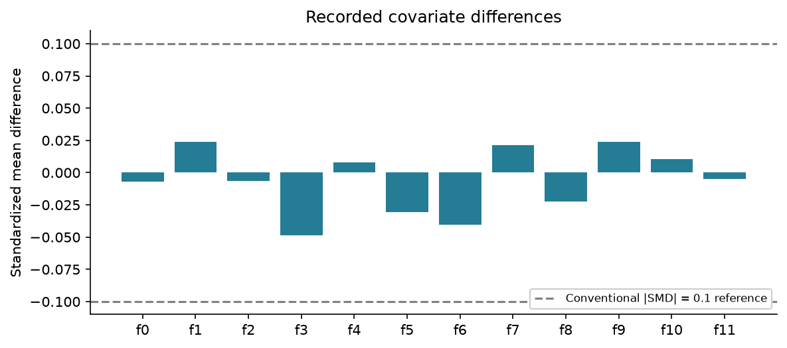
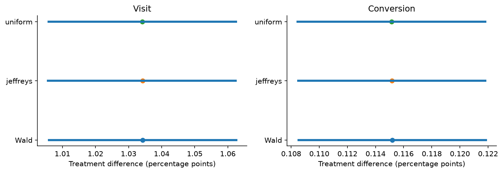
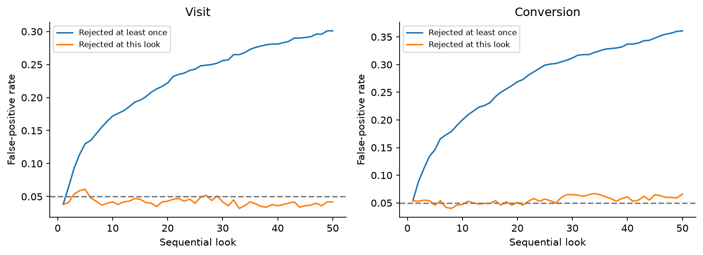
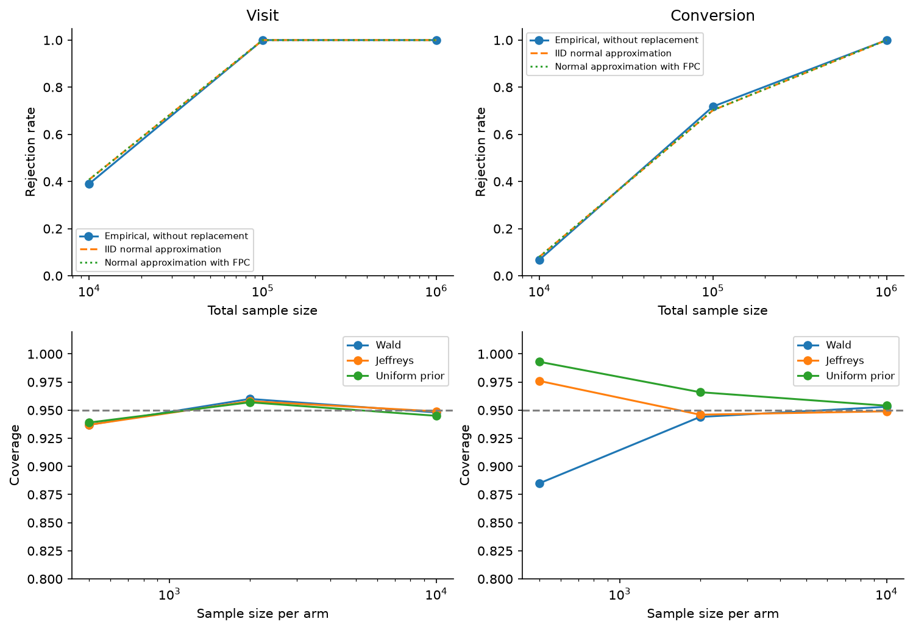
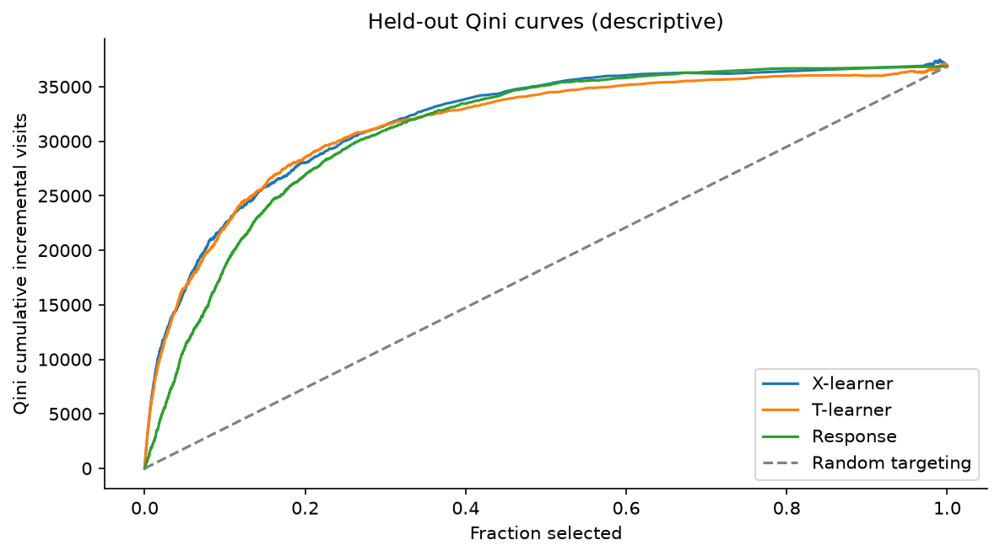
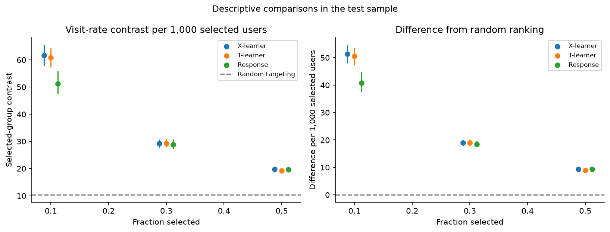

# Criteo A/B Testing & Uplift Modeling

This project compares visit and conversion rates between treatment and control in Criteo's public experiment data, then evaluates uplift rankings for a limited advertising budget. The analysis uses all 13,979,592 records. Visit is the primary outcome; conversion is secondary in the experiment analysis. Targeting models are evaluated on visit only.

The released data show substantial feature imbalance relative to randomisation variability. The estimates are therefore interpreted as descriptive comparisons within this sample. Tables and figures are saved in [results/full-run/](results/full-run/), with a summary in [CONCLUSION.md](CONCLUSION.md).

## Main results

| Outcome | Control rate | Treatment rate | Difference (pp) | Wald 95% CI (pp) | Relative lift | Two-sided p |
| --- | --- | --- | --- | --- | --- | --- |
| visit | 3.8201% | 4.8543% | 1.0342 | [1.0056, 1.0629] | 27.07% | < 1e-300 |
| conversion | 0.1938% | 0.3089% | 0.1152 | [0.1085, 0.1219] | 59.45% | 7.31e-179 |

| Model | Normalized Qini coefficient | Bootstrap 95% CI |
| --- | --- | --- |
| x_learner | 0.090007 | [0.084828, 0.095215] |
| t_learner | 0.087189 | [0.081585, 0.092334] |
| response | 0.084187 | [0.078853, 0.090846] |

X-learner is the pre-specified primary model. T-learner and a response ranking serve as benchmarks. Model choice and hyperparameters were fixed before evaluating the test set.

## Data and scope

The [Criteo Uplift Prediction Dataset v2.1](https://huggingface.co/datasets/criteo/criteo-uplift) contains 2,096,937 control users and 11,882,655 treatment users (85.0000% treated). The download is checked against the release's SHA-256 and expected row count before analysis.

Criteo pooled several incrementality experiments and applied non-uniform sub-sampling for privacy. The sampling scheme is not documented, and the original incrementality level cannot be recovered. The average contrasts, IV estimates and targeting gains below describe the released sample; they are not estimates of Criteo's actual advertising effect.

All 12 features pass the conventional |SMD| < 0.1 screen, but this is not a test of randomisation at this sample size. Under simple random assignment, an SMD would have an approximate standard deviation of 0.00075. The observed absolute SMDs are 7 to 65 such standard deviations across the features. These differences provide strong evidence that assignment is not independent of the recorded features in the released sample. Criteo's non-uniform privacy sub-sampling is a plausible explanation.

The change in the visit estimate from 1.03 to 0.77 percentage points after adjustment is consistent with imbalance in outcome-predictive covariates. Uplift evaluation compares treatment and control users within each selected group and uses the same assignments, so its results are descriptive of this sample.



Maximum absolute SMD is 0.04884 (about 65 randomisation standard deviations). The reference standard deviation is calculated as `sqrt(1/n_treatment + 1/n_control)`; feature-level values are saved in [balance_diagnostics.json](results/full-run/balance_diagnostics.json). The anonymous features are treated as numeric predictors, so differences in their means provide only a partial description of imbalance. The original allocation probability is unavailable for a definitive sample-ratio mismatch test.

## Frequentist and Bayesian comparisons

Groups are defined by treatment assignment. Absolute differences are reported in percentage points (pp). Relative lift and its delta-method interval are available in [frequentist.csv](results/full-run/frequentist.csv). The z-test uses pooled null variance, and the Wald interval uses unpooled variance. A p-value below numerical precision is displayed as `< 1e-300`. Expected losses use scientific notation; a zero Monte Carlo estimate does not imply that the true posterior loss is exactly zero.

| Outcome | Prior | P(difference > 0) | 95% credible interval (pp) | Expected loss: treatment | Expected loss: control |
| --- | --- | --- | --- | --- | --- |
| visit | jeffreys | 1.00000 | [1.0053, 1.0627] | 0.000e+00 | 1.034e-02 |
| visit | uniform | 1.00000 | [1.0055, 1.0628] | 0.000e+00 | 1.034e-02 |
| conversion | jeffreys | 1.00000 | [0.1084, 0.1219] | 0.000e+00 | 1.152e-03 |
| conversion | uniform | 1.00000 | [0.1084, 0.1219] | 0.000e+00 | 1.152e-03 |

Expected loss is measured in outcome probability per user. The Bayesian analysis uses uniform and Jeffreys Beta priors. No informative prior was used because no independent historical data were available. The coverage experiment compares interval behaviour in smaller samples.



## Full-data covariate adjustment

| Outcome | Unadjusted difference (pp) | Adjusted difference (pp) | Adjusted 95% CI (pp) | Adjusted HC2 SE | Unadjusted HC2 SE | SE ratio |
| --- | --- | --- | --- | --- | --- | --- |
| visit | 1.0342 | 0.7734 | [0.7477, 0.7991] | 0.000131257 | 0.000146316 | 0.8971 |
| conversion | 0.1152 | 0.1002 | [0.0935, 0.1068] | 3.39774e-05 | 3.43717e-05 | 0.9885 |

The fully interacted Lin model is fitted as separate OLS regressions in each arm, evaluated at the pooled covariate mean. This mean is treated as fixed. Two passes through the data compute the regression estimates and HC2 variance in chunks. The unadjusted comparison uses the HC2 variance from a treatment-only regression on the same observations. The dataset has no pre-experiment outcomes for the original CUPED construction.

Adjustment standardises the comparison to a common covariate mean, changing the point estimate as well as its standard error. The shift is consistent with the feature imbalance described above. Adjusting for the recorded covariates does not recover the original experiment or establish a causal interpretation for the released sample.

## A/A, power, peeking and coverage

| Outcome | A/A rejection rate | Fixed final-look rejection | Any-look peeking rejection |
| --- | --- | --- | --- |
| visit | 5.500% | 4.200% | 30.100% |
| conversion | 4.800% | 6.600% | 36.100% |

Power and coverage are empirical rejection and coverage rates under repeated sampling without replacement from the full public sample, treated as a finite population whose difference in visit rates is the reference value. For conversion, the full-sample conversion-rate difference is the reference value.

A/A splits the complete control pool into complementary random halves. Peeking adds disjoint groups from the remaining control pool at each look. Joint hypergeometric counts preserve the visit/conversion pairing. These simulations assess the statistical procedures under the specified sampling designs; they do not establish random assignment in the released dataset. Monte Carlo intervals, minimum detectable effects and analytical power approximations are included in the saved results.

Coverage is evaluated for ordinary Wald and independent Beta posterior intervals without a finite-population correction. The power figure includes the IID normal approximation and an approximation with a finite-population correction to the alternative variance. Both use the same pooled-z rejection rule.




## Exposure IV

| Outcome | Wald ratio (pp) | 95% CI (pp) | Naive exposed/unexposed contrast (pp) |
| --- | --- | --- | --- |
| visit | 28.6996 | [27.9112, 29.4880] | 37.9677 |
| conversion | 3.1964 | [3.0100, 3.3828] | 5.2590 |

First-stage exposure difference: 0.036037; first-stage F statistic: 444220.21. The robust ratio variance includes covariance between the outcome and exposure contrasts.

Using assignment as an instrument for actual exposure, the Wald ratio has a complier/local average causal interpretation under: (i) random assignment within the released sample; (ii) exclusion, so assignment affects outcomes only through exposure; (iii) the compliance assumptions below; (iv) relevance; and (v) SUTVA, with no interference and a single version of exposure. The observed control exposure rate is 0.000000%. Under one-sided noncompliance, all observed exposed users are compliers. With random assignment, they are representative of the complier population, so the CACE also equals the average effect of exposure on the exposed (ATT), subject to the assumptions and sampling caveat above. The estimate also depends on the accuracy of the exposure flag. The balance diagnostics show that assignment is not independent of the features in the released sample, so assumption (i) is doubtful and the IV estimate should be read as descriptive of this sample.

## Held-out uplift and targeting

The training split contains 70% of the data and is stratified by (treatment, visit), with seed 2026. LightGBM uses the parameters in [configuration.json](results/full-run/configuration.json), with no tuning or early stopping. The response baseline ranks users by the treated response model. X-learner combines its effect models using the training treatment fraction as a constant weight.



The metric is expressed as incremental visits per 1,000 users selected by the policy and assigned to treatment (intention-to-treat, including users who were assigned but not exposed). Each policy estimate is the treatment/control visit-rate difference in its top-k set, multiplied by 1,000. Random targeting uses the difference across the entire test set. Improvement is the policy estimate minus this random benchmark, on the same per-user scale. Given the covariate imbalance between assignment groups in the released data, these are descriptive ranking comparisons rather than identified causal targeting gains.

| Model | Selected | Policy increment | 95% CI | Random increment | Improvement | 95% CI of improvement |
| --- | --- | --- | --- | --- | --- | --- |
| x_learner | 10% | 61.659 | [57.782, 65.462] | 10.343 | 51.316 | [47.972, 54.612] |
| x_learner | 30% | 29.267 | [27.740, 30.694] | 10.343 | 18.924 | [17.865, 20.026] |
| x_learner | 50% | 19.734 | [18.758, 20.628] | 10.343 | 9.391 | [8.913, 9.896] |
| t_learner | 10% | 60.836 | [57.288, 64.433] | 10.343 | 50.493 | [47.322, 53.717] |
| t_learner | 30% | 29.290 | [27.841, 30.900] | 10.343 | 18.947 | [17.857, 20.136] |
| t_learner | 50% | 19.294 | [18.371, 20.110] | 10.343 | 8.951 | [8.426, 9.446] |
| response | 10% | 51.208 | [47.566, 55.894] | 10.343 | 40.865 | [37.512, 44.906] |
| response | 30% | 28.840 | [27.274, 30.771] | 10.343 | 18.496 | [17.461, 19.851] |
| response | 50% | 19.685 | [18.666, 20.712] | 10.343 | 9.342 | [8.874, 9.949] |

The random-targeting estimate is 10.343 (bootstrap 95% CI [9.807, 10.855]). It is shared across models and budgets because all comparisons use the same test resamples.



Qini is calculated with `sklift.metrics.qini_auc_score(negative_effect=True)`, including its normalisation and grouping of tied scores. Ties at targeting cutoffs are broken with fixed seeded random keys.

The paired bootstrap draws a sample of the original test-set size with replacement. Each replicate reselects floor(k*n) rows, splits repeated-row counts at the cutoff where necessary, and recalculates the random baseline. All models use the same draws. The 200 replicates give percentile intervals that are pointwise across models and budgets. The fitted models remain fixed, so these intervals cover test-sample uncertainty only. They do not account for bias from the released sample's assignment mechanism.

## Reproduce

With Python 3.12 installed, run from the project directory:

```bash
bash run.sh
```

On macOS, double-clicking `Run_Project.command` runs the same command. The script creates a virtual environment, installs the locked dependencies, downloads the data and runs the analysis. It then updates the reports and executes the notebooks from saved results. Existing data and model checkpoints are reused. Set `CRITEO_THREADS` to control the CPU thread count; the default is 4. The script also supports Linux.

Raw data and model caches are stored in `data/`, which is excluded from version control. Each run saves results in a separate folder. Numerical content in the README and conclusion is filled from the result files.

[manifest.json](results/full-run/manifest.json) records analysis commit `6928958aac539e9314c5d992203a826e9d1e5037`, the source fingerprint, package versions, data SHA-256, seeds, hardware, timings and sampled process-tree memory. Timing and memory measurements apply to that invocation. Reused results are marked, and the original uplift computation time is retained separately.

## Repository

- `sql/`: full-data validation and descriptive queries.
- `src/`: download, analysis, simulation, full-data adjustment, uplift and report generation.
- `notebooks/`: five notebooks presenting the saved analysis results.
- `results/`: generated numerical outputs, figures and manifests.
- `CONCLUSION.md`: summary of findings and limitations.

## Licenses and references

Project code: [MIT](LICENSE). Dataset: [CC BY-NC-SA 4.0](https://creativecommons.org/licenses/by-nc-sa/4.0/), under the [Criteo data terms](https://ailab.criteo.com/criteo-uplift-prediction-dataset/). The dataset is downloaded separately and is not redistributed or relicensed by the code license.

1. Diemert, E., Betlei, A., Renaudin, C. & Amini, M.-R. (2018). [A Large Scale Benchmark for Uplift Modeling](https://www.adkdd.org/papers/a-large-scale-benchmark-for-uplift-modeling/2018). AdKDD & TargetAd Workshop.
2. Deng, A., Xu, Y., Kohavi, R. & Walker, T. (2013). [Improving the sensitivity of online controlled experiments by utilizing pre-experiment data](https://doi.org/10.1145/2433396.2433413). WSDM.
3. Lin, W. (2013). [Agnostic notes on regression adjustments to experimental data: Reexamining Freedman's critique](https://doi.org/10.1214/12-AOAS583). Annals of Applied Statistics, 7(1), 295-318.
4. Angrist, J. D., Imbens, G. W. & Rubin, D. B. (1996). [Identification of causal effects using instrumental variables](https://doi.org/10.1080/01621459.1996.10476902). JASA, 91(434), 444-455.
5. Künzel, S. R., Sekhon, J. S., Bickel, P. J. & Yu, B. (2019). [Metalearners for estimating heterogeneous treatment effects using machine learning](https://doi.org/10.1073/pnas.1804597116). PNAS, 116(10), 4156-4165.
6. Radcliffe, N. J. (2007). [Using control groups to target on predicted lift: Building and assessing uplift model](https://www.research.ed.ac.uk/en/publications/using-control-groups-to-target-on-predicted-lift-building-and-ass/). Direct Marketing Analytics Journal, 14-21.

